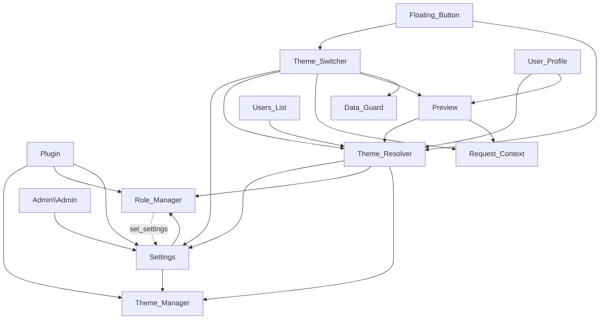
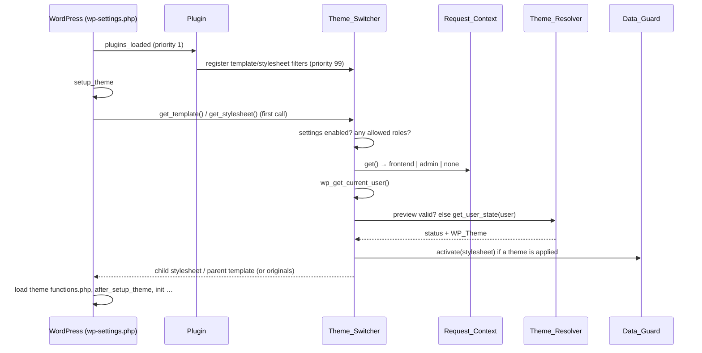

# ThemeToggle architecture

How the plugin is put together, the WordPress lifecycle it relies on, and the rules that keep it safe. Read this before changing theme resolution, request classification or the data guard.

## Service graph

`ThemeToggle\Plugin::init()` (on `plugins_loaded`, priority 1) is the composition root. Every service gets its dependencies through its constructor; nothing is a singleton except the `Plugin` instance returned by `ThemeToggle\plugin()`.

`Role_Manager` receives `Settings` through a setter because `Settings` needs `Role_Manager` to validate role slugs on save.

`User_Profile`, `Users_List` and `Admin\Admin` are only built when `is_admin()`.

| Class | Responsibility | Main hooks |
| --- | --- | --- |
| `Plugin` | Build services once, register hooks, load textdomain | `plugins_loaded:1`, `init` |
| `Installer` | Seed default `tt_settings` on activation | activation hook |
| `Settings` | Defaults, read cache, `register_setting`, per-tab sanitising | `admin_init`, `update_option_tt_settings` |
| `Theme_Manager` | `wp_get_theme( $slug )` cache, installed-theme list, labels | — |
| `Role_Manager` | Eligible roles of a user, union of permitted themes | — |
| `Theme_Resolver` | Preference → status (`none`, `active`, `disabled`, `not_eligible`, `not_allowed`, `missing`, `is_default`); save with validation | role / meta change hooks (cache flush) |
| `Request_Context` | `frontend` / `admin` / `none` for the current request | — |
| `Preview` | Validate `tt_preview` + nonce; "Use this theme" handler | `admin_post_tt_select_theme` |
| `Theme_Switcher` | `template` / `stylesheet` filters, per-request cache, no-cache headers | `template:99`, `stylesheet:99`, `send_headers` |
| `Data_Guard` | Theme-mod isolation, `sidebars_widgets` write block | `pre_option_theme_mods_{default}`, `pre_update_option_*` |
| `User_Profile` | Profile section render + save + error reporting | `show_user_profile`, `edit_user_profile`, `personal_options_update`, `edit_user_profile_update`, `user_profile_update_errors` |
| `Floating_Button` | Button / preview bar, reset handler | `wp_footer`, `admin_footer`, `admin_post_tt_reset_theme` |
| `Users_List` | Column, sort, bulk reset, notice | `manage_users_*`, `pre_get_users`, `bulk_actions-users`, `handle_bulk_actions-users` |
| `Admin\Admin` | Settings page, tabs, assets, reset-all | `admin_menu`, `admin_enqueue_scripts`, `admin_post_tt_reset_all` |
| `Redirect` | Same-site redirect target for every POST handler | — |

## Request lifecycle

Resolution happens once; the result (theme or "none") is cached in `Theme_Switcher::$applied` for the rest of the request.

### Resolution order (`Theme_Switcher::determine_theme()` + `Theme_Resolver::compute_state()`)

1. `tt_settings.enabled` is true and at least one role is allowed.
2. Request context is not `none`; if it is `admin`, `enable_admin` is true.
3. The user is logged in.
4. A valid preview (frontend page view only, nonce bound to user and theme, theme selectable) wins for this request.
5. The saved `tt_user_theme`:
   1. not empty;
   2. the user has an eligible role;
   3. the theme exists, its stylesheet passes `validate_file()`, and `WP_Theme::errors()` is empty (child themes need their parent);
   4. it is permitted by at least one eligible role;
   5. it is not the globally active theme.
6. Otherwise: no override.

### Request context (`Request_Context::detect()`)

| Request | Context |
| --- | --- |
| WP-CLI, cron, XML-RPC, installing | `none` |
| Customizer (`wp_customize`, `customize_changeset_uuid`, `customize.php`) | `none` |
| AJAX / admin-post / REST | From the `Referer`: missing or foreign → `none`; a wp-admin page → `admin` unless excluded; anything else on the site → `frontend`. Excluded AJAX actions → `none`. |
| wp-admin page | `admin`, or `none` on excluded pages |
| Everything else | `frontend` |

REST is detected before `parse_request` (when `REST_REQUEST` is not yet defined) from `rest_route` or the REST URL prefix in `REQUEST_URI`.

Excluded admin pages: `themes.php` (also covers this plugin's page), `theme-install.php`, `theme-editor.php`, `site-editor.php`, `customize.php`, `widgets.php`, `nav-menus.php`, `update.php`, `update-core.php`.

## Invariants

Breaking any of these is a bug, whatever the feature request says.

1. Never write the `template`, `stylesheet` or `current_theme` options and never call `switch_theme()`.
2. Never call `wp_get_theme()` without an argument, and never call `get_stylesheet()` / `get_template()` inside resolution code: they are filtered by this plugin and would recurse. Read the global theme with `get_option( 'stylesheet' )`.
3. A saved preference is never permission. Every read goes through `Theme_Resolver::get_user_state()`; every write goes through `Theme_Resolver::save_preference()`, which validates against the target user's current roles.
4. Invalid preferences are ignored, not deleted. Only explicit user/admin actions delete `tt_user_theme`.
5. Every state-changing request checks a nonce and a capability, and redirects only through `Redirect::get_target()`.
6. While a theme is applied, `Data_Guard` must be active: theme mods go to the selected theme's row and `sidebars_widgets` is not written.
7. Responses rendered with a user-specific theme are never publicly cacheable.
8. Nothing on the resolution path lists all themes (`wp_get_themes()` is admin-screen only).
9. No translation calls before `init` (WordPress 6.7+ warns on early textdomain loading). Settings defaults hold `''` for the label for this reason.
10. Resolution must be safe before the user is known: if `plugins_loaded` has not fired or `wp_get_current_user()` does not exist, return the original value and do not cache.
11. A theme coming from the `themetoggle_applied_theme` filter gets the same checks as a saved preference (installed, `errors()` empty), and nothing is applied when the request context is `none`. A broken theme reaching the Themes screen or the Customizer would make `validate_current_theme()` call `switch_theme()` and change the site's real theme.
12. Stored settings that reach output are re-validated there (`Settings::get_clean()`), not only on save: `esc_attr()` stops attribute breakout but not CSS injected inside a `style` attribute.
13. Scripts in `bin/` are command-line only (`PHP_SAPI` guard): a git checkout can sit under a web root.

## Settings storage

`tt_settings` is one autoloaded array. Each settings tab posts a hidden `tt_settings[_tab]`; `Settings::sanitize()` then replaces only that tab's keys (`Settings::TAB_KEYS`) and keeps the rest. Without `_tab` (programmatic updates, and WordPress's second sanitize pass when the option is first created) the whole array is validated. Unknown keys are dropped.

Role slugs are matched exactly against `wp_roles()` (not `sanitize_key()`: third-party roles may contain upper case). Theme slugs must pass `Theme_Manager::is_installed()`.

## Security model

| Action | Endpoint | Nonce | Capability |
| --- | --- | --- | --- |
| Save settings | `options.php` (Settings API) | `tt_settings_group-options` | `manage_options` |
| Save own / other profile theme | `profile.php`, `user-edit.php` | core `update-user_{id}` + `tt_save_user_theme_{id}` | `edit_user` on the target |
| Reset own theme (button) | `admin-post.php?action=tt_reset_theme` | `tt_reset_theme` | logged in |
| Use previewed theme | `admin-post.php?action=tt_select_theme` | `tt_select_theme` | logged in + `can_user_select()` |
| Preview | frontend `?tt_preview=…&tt_preview_nonce=…` | `tt_preview_{stylesheet}` (user-bound) | eligible + permitted |
| Bulk reset | `users.php` bulk action | `bulk-users` (checked by the plugin; core does not) | `edit_users` + `edit_user` per user |
| Reset all | `admin-post.php?action=tt_reset_all` | `tt_reset_all` + confirm checkbox | `manage_options` |

No `nopriv` handlers exist. Output is escaped at the point of output; request data is unslashed and sanitised on read.

## Extending

- New setting → add it to `Settings::get_defaults()`, the right `Settings::TAB_KEYS` list and `Settings::sanitize_value()`, render it in the tab view, then cover it in `tests/e2e/http-tests.sh`.
- New screen that must never be switched → add it in `Request_Context::is_excluded_admin_page()` (or use the `themetoggle_excluded_admin_pages` filter from outside).
- New core data keyed by the raw `stylesheet` option → protect it in `Data_Guard::activate()`.
- Multisite → change `Theme_Resolver::META_KEY` usage to a per-site key (for example `get_user_option()` / `update_user_option()`), decide network vs site settings, and add tests. Do not claim support until it is tested.
